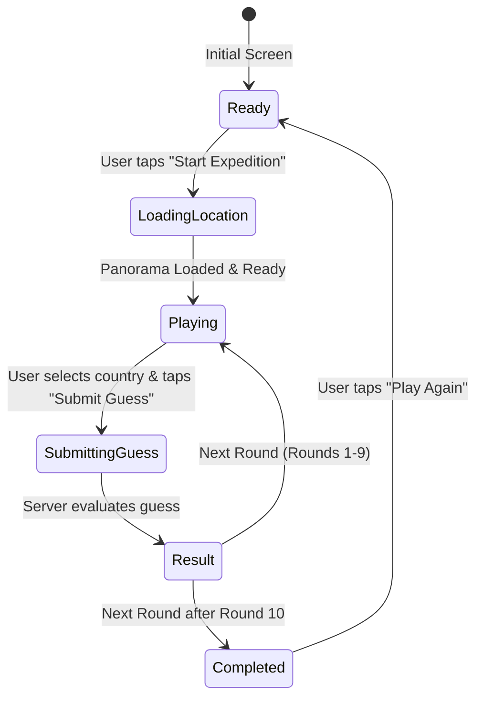
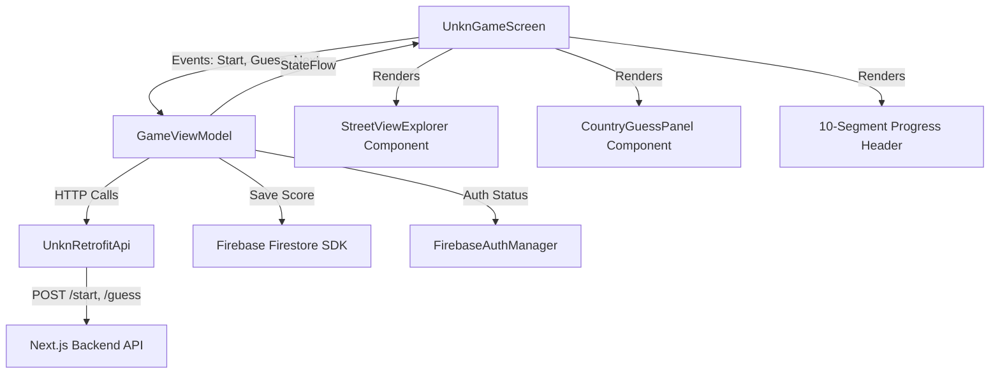

# UNKN (Guess the Country) — Android Engineering Specification & Design System

This specification defines the complete architecture, UI tokens, Google Maps/Street View SDK integration, state machine, API contracts, and Jetpack Compose/Kotlin implementations for building the native Android edition of **`unkn` (Guess the Country)** matching the web experience at `xweet.in/unkn`.

---

## 1. Editorial Cartography Design Tokens (Strict Light Mode)

The UNKN visual identity is an **artisanal, editorial cartography tool / tactile brutalist game studio**. Avoid generic dark-mode templates or modern neon themes.

### Core Color Palette Table

| Token Name | Hex Code | Jetpack Compose `Color` | Usage in UNKN Game |
|---|---|---|---|
| **Carbon** | `#171815` | `Color(0xFF171815)` | Primary typography, headers, dark buttons, high-contrast borders, active round indicator. |
| **Paper** | `#F0EFE6` | `Color(0xFFF0EFE6)` | Default canvas background, modal surfaces, light controls, map overlays. |
| **Signal Lime** | `#D7F36A` | `Color(0xFFD7F36A)` | Primary CTA ("Start Expedition", "Submit Guess"), correct answers, score badges. |
| **Terrain** | `#858779` | `Color(0xFF858779)` | Secondary text, telemetry coordinates, subtle borders, inactive round segments. |
| **Mist** | `#B7A7D9` | `Color(0xFFB7A7D9)` | Rare accent, clue tags, compass accents, soft highlights. |

### Semantic Surface Tokens (`Color.kt`)

```kotlin
package in.xweet.unkn.ui.theme

import androidx.compose.ui.graphics.Color

val Carbon = Color(0xFF171815)
val Paper = Color(0xFFF0EFE6)
val SignalLime = Color(0xFFD7F36A)
val Terrain = Color(0xFF858779)
val Mist = Color(0xFFB7A7D9)

// Alpha Variations & Surface Overlays
val BorderMuted = Terrain.copy(alpha = 0.30f)
val SurfaceCard = Color.White.copy(alpha = 0.60f)
val TelemetryBg = Carbon.copy(alpha = 0.85f)
val CorrectBg = SignalLime.copy(alpha = 0.20f)
val IncorrectBg = Carbon.copy(alpha = 0.08f)
```

---

## 2. Typography & Spatial Geometry

### Font Family Mappings

| Web Font | Android Equivalent | Usage |
|---|---|---|
| **Space Grotesk** | `FontFamily(Font(R.font.space_grotesk_medium))` | Editorial titles ("Guess the Country", "Expedition Results", modal titles). |
| **Geist Sans** | `FontFamily(Font(R.font.geist_regular))` / Roboto | Country names, body descriptions, dropdown items. |
| **Geist Mono** | `FontFamily.Monospace` or `Font(R.font.geist_mono)` | Coordinates (`35.0528° N, 135.7906° E`), round indices (`01 / 10`), scores (`8 / 10`). |
| **Playwrite Script** | `FontFamily(Font(R.font.playwrite_de_grund))` | Brand logo mark (`"unkn"`). |

### Geometry & Shape Constants
* **Viewports & Street View Frame**: `RoundedCornerShape(24.dp)` with `1.dp` border of `Terrain.copy(alpha = 0.35f)`.
* **Dropdown & Search Panels**: `RoundedCornerShape(20.dp)` to `RoundedCornerShape(24.dp)`.
* **Action Buttons**: `RoundedCornerShape(50)` (full pill).
* **Round Progress Indicators**: 10 horizontal pill capsules (`height = 6.dp`, `width = 24.dp`).

---

## 3. Game State Machine & Expedition Lifecycle

The game runs as a **10-Round Expedition**. Each round drops the player into a verified 360° Google Street View panorama at a mystery global location.



### State Definitions
1. **`Ready`**: Base station welcome card. Explains rules, introduces 10-round format, and has the `"Start Expedition"` primary CTA.
2. **`LoadingLocation`**: Initializes game session, requests coordinates, and streams the Street View panorama. Displays minimal radar/telemetry spinner.
3. **`Playing`**: Street View panorama interactive (pan, zoom, move along road). Searchable country dropdown active.
4. **`SubmittingGuess`**: Network submission of selected country code (`ISO-3166-1 alpha-2`). Controls disabled.
5. **`Result`**: Round outcome breakdown. Displays `"CORRECT (+1 pt)"` or `"INCORRECT (+0 pt)"`, shows actual country vs user's guess with flags, and provides a `"Next Round"` CTA.
6. **`Completed`**: 10-round audit report. Displays final score (`X / 10`), accuracy percentage, round-by-round breakdown with coordinates, and optional Firebase Firestore archiving.
7. **`Error`**: Fallback state if Street View fails to load or API key is missing/invalid, offering a clear `"Try Again"` recovery.

---

## 4. Google Maps & Street View Android SDK Integration

### Crucial Anti-Cheating & Gameplay Rules
* **Road Labels MUST Be Disabled**: Never display road names, highway numbers, or address plaques (`isStreetNamesEnabled = false`).
* **Navigation Controls**: Allow panning, tilting, zooming, and traveling along the road via taps (`isUserNavigationEnabled = true`).
* **North Compass Reset**: A dedicated on-screen compass button that resets camera heading to North (`heading = 0°`).
* **Fullscreen Mode**: Ability to maximize the panorama view to 100% of screen height.

### Android SDK Setup (`build.gradle.kts`)

```kotlin
dependencies {
    implementation("com.google.android.gms:play-services-maps:18.2.0")
    // Google Maps Compose
    implementation("com.google.maps.android:maps-compose:4.3.0")
}
```

### StreetView Panorama View in Jetpack Compose

```kotlin
package in.xweet.unkn.ui.components

import androidx.compose.foundation.border
import androidx.compose.foundation.layout.*
import androidx.compose.foundation.shape.RoundedCornerShape
import androidx.compose.runtime.*
import androidx.compose.ui.Modifier
import androidx.compose.ui.draw.clip
import androidx.compose.ui.platform.LocalContext
import androidx.compose.ui.unit.dp
import androidx.compose.ui.viewinterop.AndroidView
import com.google.android.gms.maps.StreetViewPanoramaView
import com.google.android.gms.maps.model.LatLng
import com.google.android.gms.maps.model.StreetViewPanoramaCamera
import in.xweet.unkn.ui.theme.BorderMuted

@Composable
fun StreetViewExplorer(
    lat: Double,
    lng: Double,
    heading: Float = 0f,
    pitch: Float = 0f,
    modifier: Modifier = Modifier,
    onBearingChanged: (Float) -> Unit = {}
) {
    val context = LocalContext.current
    val panoramaView = remember { StreetViewPanoramaView(context) }

    AndroidView(
        factory = {
            panoramaView.apply {
                onCreate(null)
                onResume()
                getStreetViewPanoramaAsync { panorama ->
                    // ANTI-CHEAT: Hide street and city names
                    panorama.isStreetNamesEnabled = false
                    panorama.isUserNavigationEnabled = true
                    panorama.isPanningGesturesEnabled = true
                    panorama.isZoomGesturesEnabled = true

                    // Position Camera
                    panorama.setPosition(LatLng(lat, lng))
                    panorama.animateTo(
                        StreetViewPanoramaCamera.Builder()
                            .bearing(heading)
                            .tilt(pitch)
                            .zoom(1f)
                            .build(),
                        500
                    )

                    panorama.setOnStreetViewPanoramaCameraChangeListener { camera ->
                        onBearingChanged(camera.bearing)
                    }
                }
            }
        },
        update = { view ->
            view.getStreetViewPanoramaAsync { panorama ->
                panorama.setPosition(LatLng(lat, lng))
            }
        },
        modifier = modifier
            .clip(RoundedCornerShape(24.dp))
            .border(1.dp, BorderMuted, RoundedCornerShape(24.dp))
    )
}
```

---

## 5. Server-Side Answer Secrecy & API Contracts

> [!IMPORTANT]
> The target country name and code must **NEVER** be sent to the Android client prior to the user's guess submission. The client only receives coordinate telemetry (`lat`, `lng`, `heading`, `pitch`).

### Endpoint 1: Start Expedition
* **Route**: `POST /api/game/start`
* **Response Body**:

```json
{
  "success": true,
  "gameId": "exp_1732204800000_a8bc12d",
  "initialRound": {
    "roundIndex": 0,
    "totalRounds": 10,
    "location": {
      "id": "loc_jp_kyoto",
      "lat": 35.0528,
      "lng": 135.7906,
      "heading": 90.0,
      "pitch": 0.0
    }
  }
}
```

### Endpoint 2: Submit Country Guess
* **Route**: `POST /api/game/guess`
* **Request Body**:

```json
{
  "gameId": "exp_1732204800000_a8bc12d",
  "roundIndex": 0,
  "selectedCountryCode": "JP"
}
```

* **Response Body**:

```json
{
  "success": true,
  "isCorrect": true,
  "pointsEarned": 1,
  "totalScore": 1,
  "roundIndex": 0,
  "isCompleted": false,
  "actualCountry": {
    "name": "Japan",
    "code": "JP",
    "continent": "Asia",
    "flag": "🇯🇵"
  },
  "selectedCountry": {
    "name": "Japan",
    "code": "JP",
    "continent": "Asia",
    "flag": "🇯🇵"
  },
  "nextRound": {
    "roundIndex": 1,
    "totalRounds": 10,
    "location": {
      "id": "loc_is_vik",
      "lat": 63.4246,
      "lng": -19.0182,
      "heading": 145.0
    }
  }
}
```

### Endpoint 3: Expedition Summary Audit
* **Route**: `GET /api/game/summary?gameId={gameId}`
* **Response Body**: Complete 10-round record with coordinates, actual countries, player choices, and total points.

---

## 6. Searchable Country Guesser Component

The player guesses by searching among ~140 supported countries.
* Search matches country **name**, **ISO code**, or **continent** case-insensitively.
* Displays country flag emoji (`flag`), full name, and continent badge.
* The "Submit Guess" CTA requires a country to be actively selected.

### Country Model (`Country.kt`)

```kotlin
package in.xweet.unkn.data

data class Country(
    val name: String,
    val code: String,
    val continent: String,
    val flag: String
)
```

---

## 7. Expedition Rating System & Firebase Archiving

### Score Titles (Based on Score out of 10)

| Score Range | Honorific Title | Assessment |
|---|---|---|
| **8 – 10 / 10** | `Geography Master` | Exceptional geographic & cultural deduction. |
| **5 – 7 / 10** | `Seasoned Explorer` | Strong cartographic instincts. |
| **0 – 4 / 10** | `Curious Traveler` | Keep exploring global roads and landscapes. |

### Firestore Schema (`/expeditions/{gameId}`)
When authenticated (Firebase Auth Google/Email):
```json
{
  "gameId": "exp_1732204800000_a8bc12d",
  "userId": "firebase_uid_12345",
  "userEmail": "player@example.com",
  "finalScore": 8,
  "totalRounds": 10,
  "correctCount": 8,
  "accuracyPercentage": 80,
  "completedAt": "2026-11-21T23:00:00Z",
  "rounds": [
    {
      "roundNumber": 1,
      "isCorrect": true,
      "points": 1,
      "actualCountry": { "code": "JP", "name": "Japan", "flag": "🇯🇵" },
      "selectedCountry": { "code": "JP", "name": "Japan", "flag": "🇯🇵" },
      "coordinates": { "lat": 35.0528, "lng": 135.7906 }
    }
  ]
}
```

---

## 8. Android App Architecture Blueprint (MVVM + Jetpack Compose)



### Complete Android UI State (`GameUiState.kt`)

```kotlin
package in.xweet.unkn.ui

import in.xweet.unkn.data.Country

sealed interface GameStatus {
    object Ready : GameStatus
    object LoadingLocation : GameStatus
    object Playing : GameStatus
    object SubmittingGuess : GameStatus
    data class Result(
        val isCorrect: Boolean,
        val actualCountry: Country,
        val selectedCountry: Country,
        val pointsEarned: Int
    ) : GameStatus
    object Completed : GameStatus
    data class Error(val message: String) : GameStatus
}

data class LocationPayload(
    val id: String,
    val lat: Double,
    val lng: Double,
    val heading: Float = 0f,
    val pitch: Float = 0f
)

data class SummaryRoundItem(
    val roundNumber: Int,
    val actualCountry: Country,
    val selectedCountry: Country,
    val isCorrect: Boolean,
    val points: Int,
    val coordinates: Pair<Double, Double>?
)

data class GameUiState(
    val status: GameStatus = GameStatus.Ready,
    val gameId: String? = null,
    val currentRoundIndex: Int = 0,
    val totalRounds: Int = 10,
    val score: Int = 0,
    val currentLocation: LocationPayload? = null,
    val nextLocation: LocationPayload? = null,
    val selectedCountry: Country? = null,
    val pastResults: List<Boolean> = emptyList(),
    val completedRounds: List<SummaryRoundItem> = emptyList(),
    val isSavedToFirestore: Boolean = false,
    val currentHeading: Float = 0f
)
```

---

## 9. Android Development Checklist

1. [ ] **Google Cloud Console**: Enable **Maps SDK for Android** and generate an API key with application restriction (SHA-1 fingerprint & package name).
2. [ ] **Android Manifest**: Add `<meta-data android:name="com.google.android.geo.API_KEY" android:value="..." />` and `ACCESS_FINE_LOCATION` / `INTERNET` permissions.
3. [ ] **Anti-Cheat Settings**: Ensure `streetViewPanorama.isStreetNamesEnabled = false` is enforced on every panorama initialization.
4. [ ] **Theme**: Define `Carbon`, `Paper`, `SignalLime`, `Terrain`, and `Mist` in `Theme.kt`.
5. [ ] **API Client**: Implement Retrofit/Ktor client calling the Next.js API endpoints (`/api/game/start`, `/api/game/guess`).
6. [ ] **Country Dropdown**: Implement searchable lazy column with flag emojis and country codes.
7. [ ] **Progress Header**: Build 10-segment status indicator with exit confirmation dialog.
8. [ ] **Summary Screen**: Build full audit report with rating titles and optional Firestore saving.
