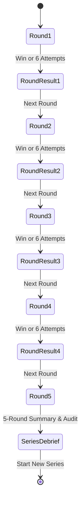
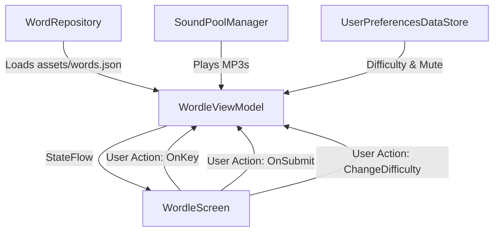

# UNKN Wordle — Android Engineering Specification & Design System

This document provides the complete design tokens, color palette, game state machine, lexical algorithms, audio triggers, and Kotlin/Jetpack Compose architecture to build the native Android edition of the **UNKN Wordle** game matching the web platform at `xweet.in/wordle`.

---

## 1. Editorial Palette & Design Tokens (Strict Light Mode)

The application adheres strictly to **Tactile Editorial Light Mode**. Avoid generic purple-blue gradients or dark-mode defaults. The interface evokes artisanal cartography, tactile print, and high-precision telemetry.

### Core Color Palette Table

| Token Name | Hex Code | Compose `Color` | Usage in Game UI |
|---|---|---|---|
| **Carbon** | `#171815` | `Color(0xFF171815)` | Primary typography, dark buttons, high-contrast borders, active round pills. |
| **Paper** | `#F0EFE6` | `Color(0xFFF0EFE6)` | Default canvas background, card surfaces, modal background. |
| **Signal Lime** | `#D7F36A` | `Color(0xFFD7F36A)` | Primary CTA buttons, correct letter tiles (**Green**), success indicators, active progress bars. |
| **Terrain** | `#858779` | `Color(0xFF858779)` | Secondary labels, borders, coordinate grids, absent keyboard keys, muted metadata. |
| **Mist** | `#B7A7D9` | `Color(0xFFB7A7D9)` | Present letter tiles (**Misplaced / Purple**), soft badges, subtle clues. |

### Semantic Surface & Alpha Accents

| Semantic Name | Value | Purpose |
|---|---|---|
| `Border Muted` | `Terrain.copy(alpha = 0.20f)` | Grid cell outlines (empty state), divider lines. |
| `Border Active` | `Carbon.copy(alpha = 0.50f)` | Grid cell outline when a letter is actively typed (`tbd`). |
| `Key Absent Bg`| `Terrain.copy(alpha = 0.25f)` | Keyboard key background when letter is absent from word. |
| `Key Default Bg`| `Color(0xFFFFFFFF).copy(alpha = 0.85f)` | Default unpressed virtual keyboard key. |
| `Surface Glass` | `Paper.copy(alpha = 0.92f)` | Floating top bars and bottom sheets with blur. |

### Jetpack Compose Color Definition (`Color.kt`)

```kotlin
package in.xweet.wordle.ui.theme

import androidx.compose.ui.graphics.Color

val Carbon = Color(0xFF171815)
val Paper = Color(0xFFF0EFE6)
val SignalLime = Color(0xFFD7F36A)
val Terrain = Color(0xFF858779)
val Mist = Color(0xFFB7A7D9)

// Derived Semantic Colors
val BorderMuted = Terrain.copy(alpha = 0.25f)
val BorderActive = Carbon.copy(alpha = 0.60f)
val KeyDefaultBg = Color.White.copy(alpha = 0.90f)
val KeyAbsentBg = Terrain.copy(alpha = 0.25f)
val KeyAbsentText = Terrain.copy(alpha = 0.60f)
```

---

## 2. Typography & Spatial Geometry

### Font Family Mapping

| Web Font | Android Equivalent | Usage |
|---|---|---|
| **Space Grotesk** | `FontFamily(Font(R.font.space_grotesk_medium))` | Modal titles, victory banners, series audit headers. |
| **Geist Sans** | `FontFamily(Font(R.font.geist_regular))` / Roboto | Main body text, button labels, descriptions. |
| **Geist Mono** | `FontFamily.Monospace` or `Font(R.font.geist_mono)` | Letters in 5x6 grid, virtual keyboard keys, round counters (`01 / 05`), scores. |
| **Playwrite Script** | `FontFamily(Font(R.font.playwrite_de_grund))` | Brand header logo text: `"wordle"`. |

### Geometry & Shape Rules
* **Tile Corners**: `RoundedCornerShape(12.dp)` to `RoundedCornerShape(14.dp)`.
* **Keyboard Key Corners**: `RoundedCornerShape(8.dp)`.
* **Modals & Cards**: `RoundedCornerShape(24.dp)` to `RoundedCornerShape(28.dp)`.
* **Action Buttons**: Fully rounded pill shapes (`RoundedCornerShape(50)`).
* **Borders**: Thin `1.dp` borders throughout to give a tactile, etched aesthetic.

---

## 3. Tournament Structure: The 5-Round Series

Unlike standard single-round Wordle games, UNKN Wordle runs in **5-Round Series Expeditions**:



### Series Rules
1. **5 Independent Rounds**: Each round gives the player a fresh secret 5-letter word and 6 attempts.
2. **Scoring**: $1\text{ pt}$ awarded per solved round ($0$ to $5$ points total).
3. **Mid-Series Modal (Rounds 1–4)**:
   - Displays verdict (`"Splendid Deduction!"` or `"Round Missed"`).
   - If missed, reveals target word with a direct **Google Definition Lookup** link:
     `https://www.google.com/search?q=define+{TARGET_WORD}`
   - Shows action button: `"Proceed to Round 0{N+1}"`.
4. **Final Series Debrief (After Round 5)**:
   - Complete tournament summary showing series score (e.g. `4 of 5 Solved`).
   - Earned Rating Title & Badge (see Section 7).
   - Full 5-round audit trail showing target words, attempt counts, and status.
   - Text export sharing button (with emoji grid).

---

## 4. Lexical Engine & Difficulty Tiers (`words.json`)

The vocabulary is backed by `words.json` (5,757 five-letter English words placed in `app/src/main/assets/words.json`). The words are ordered by natural language frequency (most common first, rare/archaic words toward the end).

### The Golden Dictionary Rule
* **Guess Validation**: Every single word in the 5,757-word list + thematic words is **always valid for player guesses** (`VALID_GUESS_SET`). No word is ever blocked from being guessed.
* **Target Word Selection**: Governed strictly by the player's selected difficulty preference.

### Difficulty Tier Classification

| Difficulty Level | Target Candidate Slices | Description |
|---|---|---|
| **Progressive** *(Recommended Default)* | Dynamic per Round (see below) | Natural ramp curve: early rounds give familiar words; final rounds test mastery. |
| **Easy / Casual** | Top `1,200` words | Everyday vocabulary (`WATER`, `APPLE`, `LIGHT`, `PLANT`). |
| **Medium / Standard** | Top `2,800` words | Balanced challenge matching classic NYT Wordle standards. |
| **Hard / Lexicographer** | Full `5,757` words | Unrestricted dictionary including archaic, literary, and rare vocabulary. |

### Progressive Round Ramp Curve
When in **Progressive** mode:
* **Round 1**: Top `900` most frequent words.
* **Round 2**: Top `1,600` words.
* **Round 3**: Top `2,600` words.
* **Round 4**: Top `3,800` words.
* **Round 5**: Full `5,757` lexicon (Grand Finale).

### Recency Anti-Repeat Filter
The game tracks the last 50 played target words in local storage/DataStore. When selecting a new target word:
$$\text{Pool} = \text{Candidates} \setminus \text{RecentWords}$$
If $\text{Pool.size} > 30$, pick randomly from $\text{Pool}$; otherwise fallback to $\text{Candidates}$.

---

## 5. Tile Evaluation & Duplicate Letter Algorithm

Wordle tile coloring requires a **two-pass evaluation** to properly handle words with duplicate letters (e.g. Target: `ROBOT`, Guess: `BOOST`).

### Evaluation States
* `CORRECT` (Green / Signal Lime `#D7F36A`): Letter is at the exact position.
* `PRESENT` (Purple / Mist `#B7A7D9`): Letter exists in target, but in another position.
* `ABSENT` (Gray / Terrain `#858779`): Letter is not in the target (or instances exceeded).

### Kotlin Reference Implementation

```kotlin
package in.xweet.wordle.logic

enum class TileState { EMPTY, TBD, CORRECT, PRESENT, ABSENT }

data class GuessEvaluation(
    val tileStates: List<TileState>,
    val correctCount: Int,
    val presentCount: Int,
    val totalMatched: Int,
    val allMissing: Boolean,
    val isClose: Boolean
)

object WordleEvaluator {

    fun evaluateGuess(guess: String, target: String): GuessEvaluation {
        val targetChars = target.uppercase().toCharArray()
        val guessChars = guess.uppercase().toCharArray()
        val states = MutableList(5) { TileState.ABSENT }
        
        // Track unconsumed letters in the target
        val remainingTarget = targetChars.toMutableList() as MutableList<Char?>

        var correctCount = 0
        var presentCount = 0

        // PASS 1: Exact matches (CORRECT / Signal Lime)
        for (i in 0 until 5) {
            if (guessChars[i] == targetChars[i]) {
                states[i] = TileState.CORRECT
                correctCount++
                remainingTarget[i] = null // Consume this letter
            }
        }

        // PASS 2: Misplaced matches (PRESENT / Mist)
        for (i in 0 until 5) {
            if (states[i] != TileState.CORRECT) {
                val matchIndex = remainingTarget.indexOf(guessChars[i])
                if (matchIndex != -1) {
                    states[i] = TileState.PRESENT
                    presentCount++
                    remainingTarget[matchIndex] = null // Consume this letter
                } else {
                    states[i] = TileState.ABSENT
                }
            }
        }

        val totalMatched = correctCount + presentCount
        val allMissing = totalMatched == 0
        // "Close": Either 4+ exact letters correct, or 4+ total letters matched
        val isClose = !allMissing && (correctCount >= 4 || totalMatched >= 4)

        return GuessEvaluation(
            tileStates = states,
            correctCount = correctCount,
            presentCount = presentCount,
            totalMatched = totalMatched,
            allMissing = allMissing,
            isClose = isClose
        )
    }
}
```

---

## 6. Audio Feedback Engine

The Android app includes 3 sound effects placed in `res/raw/`:
* `res/raw/correct.mp3`: Word guessed completely correctly (`guess == targetWord`).
* `res/raw/boom.mp3`: Guess has zero matching letters (`allMissing == true`).
* `res/raw/close.mp3`: Guess came very close (`isClose == true`).

### Sound Trigger Logic

```kotlin
fun onGuessSubmitted(guess: String, target: String) {
    if (guess == target) {
        audioManager.play(SoundType.CORRECT)
        finishRound(won = true)
        return
    }

    val evaluation = WordleEvaluator.evaluateGuess(guess, target)
    
    when {
        evaluation.allMissing -> audioManager.play(SoundType.BOOM)
        evaluation.isClose -> audioManager.play(SoundType.CLOSE)
    }

    if (currentAttempts >= 6) {
        finishRound(won = false)
    }
}
```

> [!NOTE]
> Provide an audio mute toggle in the top bar. Store mute state in `DataStore` or `SharedPreferences` under key `"wordle_muted"`.

---

## 7. Series Ratings & Audit Telemetry

At the conclusion of the 5th round, compute the player's rating based on total rounds won ($0$ to $5$):

| Rounds Won | Honorific Title | Badge Description |
|---|---|---|
| **5 / 5** | `Grandmaster Lexicographer` | Flawless Deductions |
| **4 / 5** | `Master Cryptic Solver` | 80% Precision |
| **3 / 5** | `Seasoned Wordsmith` | 60% Accuracy |
| **1–2 / 5** | `Apprentice Explorer` | Keep Honing |
| **0 / 5** | `Field Observer` | Try Another Series |

### Social Share Export Format
The app generates clipboard share text matching the web platform:

```text
Wordle 5-Round Series: 4/05 Solved

Round 01 (3/6):
⬛🟪⬛⬛⬛
⬛🟩🟩⬛⬛
🟩🟩🟩🟩🟩

Round 02 (4/6):
...

https://xweet.in/wordle
```

---

## 8. Android State Machine & Jetpack Compose Blueprint

### Architecture Overview



### Complete UI State Data Class

```kotlin
package in.xweet.wordle.ui

import in.xweet.wordle.logic.TileState

enum class Difficulty { PROGRESSIVE, EASY, MEDIUM, HARD }

data class RoundAudit(
    val roundNumber: Int,
    val targetWord: String,
    val guesses: List<String>,
    val isWon: Boolean,
    val attemptsUsed: Int
)

data class WordleUiState(
    val currentRound: Int = 1,
    val totalRounds: Int = 5,
    val difficulty: Difficulty = Difficulty.PROGRESSIVE,
    val isMuted: Boolean = false,
    val targetWord: String = "",
    val guesses: List<String> = emptyList(),
    val currentInput: String = "",
    val roundHistory: List<RoundAudit> = emptyList(),
    val isRoundComplete: Boolean = false,
    val isSeriesComplete: Boolean = false,
    val lastRoundAudit: RoundAudit? = null,
    val keyStates: Map<Char, TileState> = emptyMap(),
    val toastMessage: String? = null,
    val isShaking: Boolean = false
)
```

### Virtual Keyboard Layout & Color Priority
The virtual keyboard uses standard 3-row layout:
* **Row 1**: `Q W E R T Y U I O P`
* **Row 2**: `A S D F G H J K L`
* **Row 3**: `ENTER  Z X C V B N M  ⌫`

#### Key Color Resolution Priority:
1. `CORRECT` (`SignalLime`) — trumps any other state.
2. `PRESENT` (`Mist`) — if letter appeared elsewhere, but not yet correct.
3. `ABSENT` (`Terrain @ 25%`) — tested and completely absent.
4. `UNTOUCHED` (`White / Paper border`).

---

## 9. Deliverables & Checklist for Android Dev Team

1. [ ] **Assets**: Copy `words.json` to `app/src/main/assets/words.json`.
2. [ ] **Audio**: Copy `boom.mp3`, `close.mp3`, and `correct.mp3` to `app/src/main/res/raw/`.
3. [ ] **Theme**: Define `Carbon`, `Paper`, `SignalLime`, `Terrain`, and `Mist` in `Theme.kt`.
4. [ ] **Fonts**: Add Space Grotesk, Geist, and Geist Mono to `res/font/`.
5. [ ] **Engine**: Implement `WordleEvaluator` 2-pass matching in Kotlin.
6. [ ] **Tiers**: Implement `getRandomTargetWord(recents, difficulty, roundNumber)`.
7. [ ] **UI**: Construct 5-column grid with adaptive sizing and on-screen keyboard.
8. [ ] **Modals**: Implement Round Summary dialog with Google definition search button (`https://www.google.com/search?q=define+{WORD}`).
9. [ ] **Persistence**: Store lifetime stats (played, won, streak, maxStreak) and difficulty in Jetpack DataStore.
